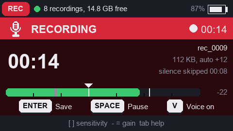
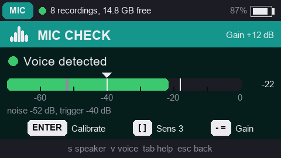
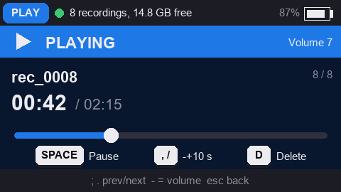

# IP9 VoiceRec

Digital voice recorder for the **M5Stack Cardputer** and **Cardputer ADV** (ESP32-S3): records directly to **MP3** files on a microSD card, featuring **room-adaptive voice activation** that skips silence, built-in microphone calibration, and an integrated audio player.

Part of the IP9 Cardputer suite – **https://cardputer.ip9.pl**. Shares the unified interface of IP9 apps (including [IP9 LG Remote](https://github.com/raptyk/IP9LGRemote)): carousel launcher cards, color-coded section bands, drawn key caps, footer hints, and detailed setting descriptions.

Author: Patryk Strzelecki <patryk@strzelecki.info> · License: MIT · https://github.com/raptyk/IP9VoiceRec

---

## Screens

| | |
|---|---|
|  |  |
| **Recording** – live voice detector, Auto level gain & skipped silence | **Mic check** – room noise baseline & 2-step voice calibration |
|  | |
| **Audio player** – playback with progress bar, ±10 s seek & volume | |

Screens are rendered at 2× from the firmware layout (`python tools/make_screenshots.py`); on the device the fonts are the M5GFX bitmap fonts.

---

## Features

* **On-the-fly MP3 encoding** (`libshine`): 16 kHz, mono, 32 / 48 / 64 kbit/s. At 48 kbit/s, approximately 21 MB per hour of speech. Files are saved as `rec_0001.mp3`, `rec_0002.mp3`… in `/recordings` – playable on any computer or mobile device.
* **Room-adaptive voice activation (VAD)**:
  - The activation threshold is not a static dBFS value, but a dynamic margin above the **continuously tracked background noise floor** (background average and variance); the same sensitivity setting works reliably in a quiet bedroom and a busy office,
  - Starts after two consecutive loud frames (72 ms) – key clicks and accidental bumps won't trigger recording,
  - **360 ms pre-roll** – the very first syllable is never cut off,
  - **Hold time** (default 1.5 s) – natural pauses between words do not split the recording,
  - A suddenly started fan holds recording for a few seconds at most before the detector adapts and treats it as background noise.
* **Mic check and calibration** (2 steps, ~8 s): 3 s of quiet (measures background noise floor and fluctuation), followed by 4.5 s of speech (measures voice level). Calibration automatically sets **microphone gain** so speech targets ~-20 dBFS, and picks optimal **sensitivity** based on measured SNR. Live view includes a level meter with marked noise floor and trigger levels.
* **Auto level – automatic recording level** (enabled by default, *Settings → Auto level*): quiet or distant voices are boosted during recording to a clear target level (speech ~-19 dBFS), while loud voices are smoothly attenuated before hitting the limiter. Works with a 0.3 s look-ahead window, so gain is already adjusted for the very first syllable, preventing clipping on sudden shouts or taps. Measures speech frames only: silence, pauses, and background noise never cause gain pumping, and noise in loud environments is capped at -42 dBFS. Dynamic range of -12…+30 dB; current gain is visible during recording (e.g. `auto +12`). Learned gain carries over to the next recording.
* **Microphone gain**: Cardputer – PDM microphone ×8 + software gain 0…30 dB; Cardputer ADV – ES8311 codec with analog PGA +21 dB (M5Unified leaves it at 0 dB, which caused previous low volume) + software gain 0…30 dB. Loud transients are softly limited instead of hard-clipped.
* **Audio player** (Helix MP3): pause, ±10 s seek, previous/next track, volume control, file deletion with confirmation.
* **Status LED indicator**: steady red = recording speech, pulsing red = listening for voice, steady amber = paused, pulsing white = saving file, two green blinks = saved successfully, two red blinks = error.
* **Display sleep during recording** (configurable timeout): recording continues in the background; the wake-up keypress is intercepted so it never accidentally stops or interrupts the recording.

---

## Controls

### Home screen

| Key | Action |
| :--- | :--- |
| `,` `/` (and `;` `.`) | Select card: Record, Recordings, Mic check, Settings, Help |
| `enter` / `G0` | Open card (Record starts recording immediately) |
| `r` | Start recording immediately (also works from the recordings list) |
| `1`–`5` | Jump directly to card by number |
| `tab` | Help |

### Recording

| Key | Action |
| :--- | :--- |
| `enter` / `G0` / `esc` / `del` | Stop and save recording |
| `space` | Pause / resume |
| `v` | Toggle voice activation on/off (on the fly) |
| `[` `]` | Adjust sensitivity (1–5) |
| `-` `=` | Adjust microphone gain (3 dB steps) |

### Recordings & Player

| Key | Action |
| :--- | :--- |
| `;` `.` | Previous / next recording |
| `enter` / `space` | Play / pause |
| `,` `/` | Seek -10 s / +10 s |
| `-` `=` | Adjust volume |
| `d` | Delete recording (with confirmation) |
| `esc` / `del` | Back |

### Mic check

| Key | Action |
| :--- | :--- |
| `enter` / `c` | Start 2-step calibration (quiet room, then speak) |
| `[` `]` / `-` `=` | Adjust sensitivity / microphone gain |
| `v` | Toggle voice activation on/off |
| `s` | Speaker test (plays tone sequence) |

---

## Pre-built binaries (`release/`)

Building the project generates in `release/`:

1. `IP9VoiceRec-<version>.bin` – application image, ready to run from SD card via **M5Launcher**,
2. `IP9VoiceRec-<version>-full.bin` – complete flash image (bootloader + partition table + application) for flashing at offset `0x0`.

```bash
esptool.py --chip esp32s3 write_flash 0x0 release/IP9VoiceRec-1.2.0-full.bin
```

## Building

Requires [PlatformIO](https://platformio.org/). The common IP9 application core, [IP9Kit](https://github.com/raptyk/IP9Kit) (application shell, menus, carousel, help screens, dialogs, keyboard input, LED indicator, battery), is automatically downloaded by PlatformIO at the version pinned in `platformio.ini`.

```bash
pio run
```

To develop IP9Kit concurrently with VoiceRec, clone IP9Kit alongside this repository (`../IP9Kit`) and copy `ip9kit-local.ini.example` to `ip9kit-local.ini`.

### Auto level simulation

`tools/autogain_sim.cpp` runs synthetic speech, noise, and clicks through the identical DSP pipeline as the firmware (`Dsp`, `VoiceDetector`, `AutoGain`) and verifies 14 test scenarios (quiet/loud speech, whispers, noisy rooms, shouts, clicks, pauses, fan noise, gain transitions, successive recordings). Compile with any C++17 compiler:

```bash
g++ -std=c++17 -O2 -Isrc tools/autogain_sim.cpp src/audio/AutoGain.cpp src/audio/Dsp.cpp src/audio/VoiceDetector.cpp -o autogain_sim
./autogain_sim
```

### Screenshot generation

Render pixel-accurate 2× preview images of the UI screens for the documentation:

```bash
python tools/make_screenshots.py
```

## Repairing recordings from v1.0.0 and v1.1.0

Early firmware versions (1.0.0 and 1.1.0) set the MP3 "padding" header bit on every frame even when frames were not padded, causing common audio players to reject them. The audio data itself is completely intact; the repair script strips this incorrect bit (creates `*_fixed.mp3`, or use `--in-place` to overwrite):

```bash
python tools/repair_mp3.py rec_0001.mp3
```

---

## License

MIT. Copyright (c) 2026 Patryk Strzelecki <patryk@strzelecki.info>.
Repository: https://github.com/raptyk/IP9VoiceRec · More IP9 apps: https://cardputer.ip9.pl
